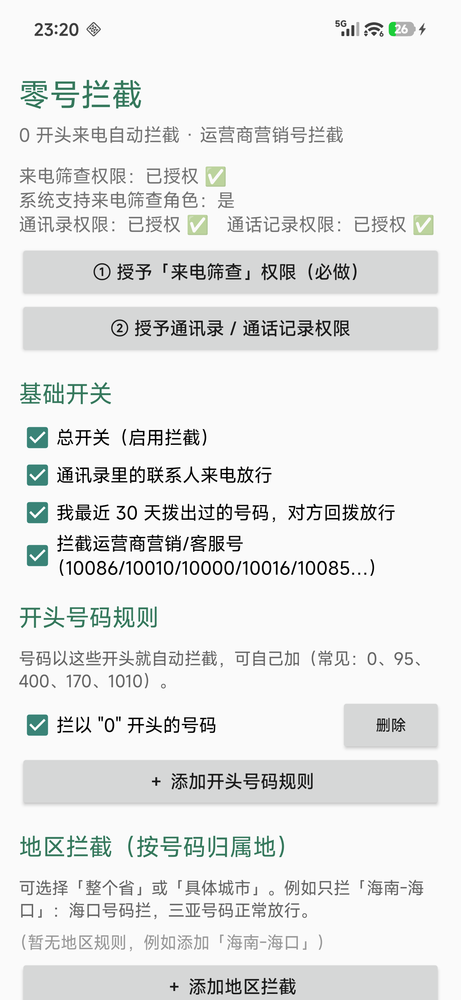
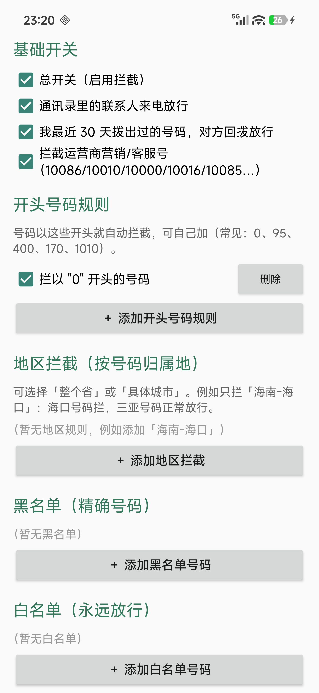
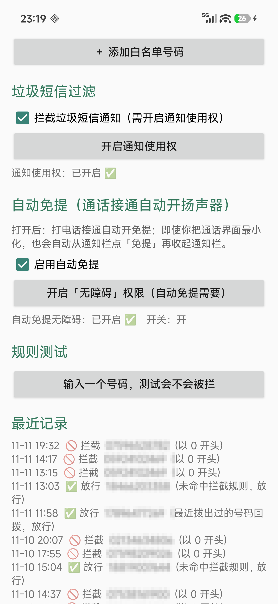
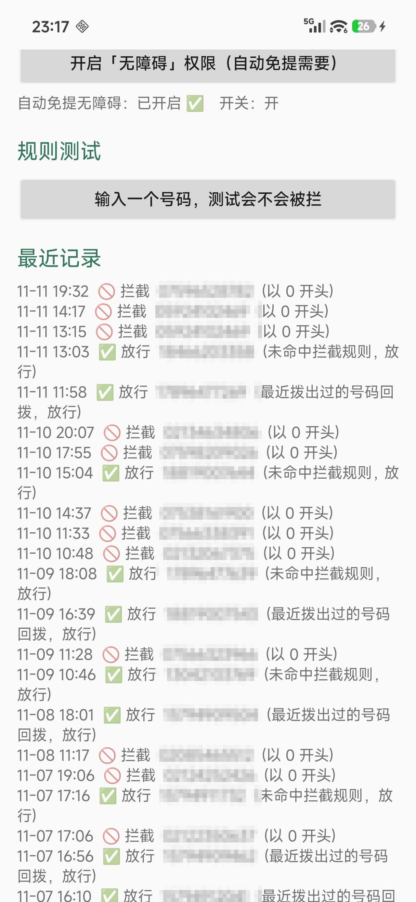

# 零号拦截 (ZeroBlocker)

一个免费的安卓来电拦截 App。

写它的原因很简单：每天被 0 开头的推销电话和运营商营销号骚扰，装过的拦截软件要么收费、要么要一堆权限、要么后台被杀掉就失效。索性自己写了一个——代码不复杂，胜在够用、权限少、全部在本机判断，不联网。

**这个项目完全免费：没有广告、没有内购、不需要激活码。** 源码就在这里，装包在 [`release/ZeroBlocker-4.0.apk`](release/ZeroBlocker-4.0.apk)，下载安装即可。

## 功能

- **0 开头来电拦截**：默认拦所有 0 开头的号码，也可以自己加 95、400、170、1010 等开头规则
- **运营商营销/客服号拦截**：10086、10010、10000、10016、10085 等
- **地区拦截**：按号码归属地拦截，精确到省和市。比如只拦「海南-海口」，海口号码拦掉，三亚正常放行
- **黑名单 / 白名单**：精确号码
- **自动放行**：通讯录里的联系人、最近 30 天你主动拨出过的号码（对方回拨）不会被拦
- **垃圾短信过滤**（可选）：按关键词拦垃圾短信通知，需要通知使用权
- **自动免提**（可选）：打电话接通自动开扬声器，通话界面被最小化了也能自动处理，需要无障碍权限

拦截发生在响铃之前，对方听到的是忙音/已拒接，你这边不会响。

## 截图

| 主界面 | 规则设置 |
| --- | --- |
|  |  |

| 自动免提 | 最近的拦截记录 |
| --- | --- |
|  |  |

（记录截图里的号码打了码，时间是 11 月这几天实际用下来的记录。）

## 安装

1. 下载 [`release/ZeroBlocker-4.0.apk`](release/ZeroBlocker-4.0.apk)，传到手机上
2. 点开安装，允许「未知来源」；小米/Redmi 上可能还会要求按指纹或输入密码验证，按提示操作即可
3. 打开 App，按页面上的 ① ② 按钮授予「来电筛查」「通讯录 / 通话记录」权限
4. 可选：点「开启通知使用权」和「开启『无障碍』权限」，用于垃圾短信过滤和自动免提

### 注意

- 小米 / HyperOS 上「通知使用权」「无障碍」都是敏感权限，系统会弹风险提示，确认即可
- 建议把这个 App 的省电策略改为「无限制」（设置 → 应用管理 → 零号拦截 → 省电策略），否则后台可能被杀，拦截会失效
- 装包是项目自签名证书签的，版本升级请用同一个包覆盖安装
- v4.0 安装包 SHA-256：0b2532e0f8bee6deb231b7784c5a11fe0c1da3cb1c22e88224982a017839beaf
- 只在小米 Redmi Turbo 4 Pro（HyperOS 3 / Android 16）上实测过，其他 Android 10 以上的机型理论上都可用（用的是系统 `CallScreeningService`）
- 微信、QQ 这类网络通话不走系统通话，拦不到也管不了

## 编译

不依赖 Gradle，直接调 Android SDK 里的命令行工具打包：

```powershell
$env:JAVA_HOME    = "C:\Program Files\Java\jdk-17"
$env:ANDROID_HOME = "C:\Android\Sdk"
powershell -ExecutionPolicy Bypass -File .\tools\build.ps1
```

需要 JDK 17、Android SDK（`platforms/android-35` 和 `build-tools`）。产物在 `release/` 下。

## 项目结构

```
app/                 源码
  AndroidManifest.xml
  src/com/dsh/zeroblocker/
    BlockerScreeningService.java   来电筛查服务（核心）
    Rules.java                     规则判断逻辑
    RuleStore.java                 规则存储
    RegionDB.java / RegionData.java 归属地数据与查询
    SmsNotificationFilter.java     垃圾短信通知过滤
    AutoSpeakerAccessibility.java  自动免提（无障碍）
    MainActivity.java              界面
  res/                 图标、无障碍服务配置
  assets/regions.bin   归属地数据（phone2region）
tools/build.ps1        构建脚本
docs/screenshots/      截图
release/               安装包
```

## 更新记录

- 2026-11-05：第一个能用的版本，0 开头号码 + 运营商营销号拦截
- 2026-11-06：加地区拦截（省/市）、黑白名单、垃圾短信过滤、自动免提
- 2026-11-11：整理成免费开源版，补了截图和构建脚本

## 作者

DeliKitch（GitHub：[@3848468527-rgb](https://github.com/3848468527-rgb)）

这个 App 和这个仓库都是我自己写的，如果有问题或者想提建议，直接开 issue。

## License

MIT License，详见 [LICENSE](LICENSE)。

号码归属地数据来自 [phone2region](https://github.com/iBugCode/phone2region)（MIT License）。